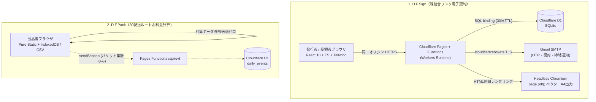

個人開発やフリーランス受託、不用品・EC物販の実務で「既存SaaSの無料枠上限やUXの重さ」に課題を感じ、**ランニングコストを極限までゼロに近づけた2つの無料Webアプリケーション**を Cloudflare エッジ基盤上で構築・本番公開しました。

1. **[D.F.Sign](https://df-sign.df-architect.dev/?utm_source=zenn&utm_medium=tech_community&utm_campaign=launch_pr)** — 登録不要A4ベクターPDF出力 ＆ 取引先ログイン不要の1分リンク電子契約サービス
   - エンジニア・個人開発受託向け専用テンプレートLP: **[システム受託・開発向け業務委託契約書LP](https://df-sign.df-architect.dev/lp/programming?utm_source=zenn)**
2. **[D.F.Pack](https://df-architect.dev/products/sedo-calc/?utm_source=zenn&utm_medium=tech_community&utm_campaign=launch_pr)** — 外部送信ゼロ・2026年最新30配送ルート一括比較 ＆ 5大フリマ手取り純利益3秒計算ツール

本稿では、個人開発者が無料ツールを継続公開するうえで致命傷になりやすい「インフラ固定費」「ブラウザPDFの日本語崩れ・プレビュー乖離」「クライアント画面の広告汚染」「プライバシー配慮型イベント計測」をどう解決したのか、実際の技術アーキテクチャと設計判断をまとめます。

---

## 全体アーキテクチャ比較：ステート最小化エッジ構成 vs 完全クライアント完結構成

2つのプロダクトは要件の性質に合わせ、Cloudflare Pages を共通基盤としながらバックエンドの責務を明確に切り分けています。



---

## 1. 『D.F.Sign』の技術設計と実装の急所

フリーランスエンジニアが小〜中規模の直契約を結ぶ際、大手電子契約SaaSでは「無料プランは月3〜5件まで」「テンプレ保存は有料のみ」「相手にもアカウント作成を強いる」といった摩擦が発生します。一方、既存の無料ツールは相手が開く画面にまでアドネットワーク広告が表示され、実務の商取引では送付しづらい課題がありました。

**[D.F.Sign](https://df-sign.df-architect.dev/?utm_source=zenn&utm_medium=tech_community&utm_campaign=launch_pr)** では、以下の4つの設計原則でこれを解決しています。

### ① 画面分離型（聖域保護）ルーティングと月間無制限の無料開放
- **完全無料・月間件数無制限**：Cloudflare Pages + Pages Functions + D1（SQLite互換）を採用し、署名成立から30日経過したレコードをアクセス時に自動パージする「管理しすぎない疎結合設計（30日TTL安全網＋双方PDF控え保存）」とすることで、ストレージ肥大化と固定費を排除しました。
- **取引先画面の広告ゼロ保証**：受領者が開く署名画面（`/c/:token`）、署名完了画面、および出力される契約書A4 PDFには広告スクリプト・PR枠を1バイトも読み込ませず、発行者側モーダル・管理画面のみに分離しています。

### ② Workers Web Crypto API による PIN 保護と SHA-256 改ざん防止証跡
取引先に会員登録を強制せず、DM（Slack / Discord / Chatwork / メール等）での URL + 暗証パスワード共有だけで1分署名を成立させるため、Workers 標準の Web Crypto API でハッシュ化と電子合意証跡を生成しています。

> **Workers 実装上の注意点**: Cloudflare Workers ランタイムの `crypto.subtle.deriveBits`（`PBKDF2`）は反復回数上限が `100,000` 回に制限されているため、Node.js 環境のデフォルト値（310,000回等）をそのまま持ち込むと実行時例外になります。

```typescript
// Cloudflare Workers Runtime 対応 PBKDF2-SHA256 & 契約書証跡ハッシュ算出例
const PBKDF2_ITERATIONS = 100_000; // Workers 上限準拠

export async function computeDocumentDigest(payload: {
  contractId: string;
  bodyCanonicalJson: string;
  signerName: string;
  signedAtIso: string;
}): Promise<string> {
  const raw = `${payload.contractId}|${payload.signedAtIso}|${payload.signerName}|${payload.bodyCanonicalJson}`;
  const buf = await crypto.subtle.digest("SHA-256", new TextEncoder().encode(raw));
  return Array.from(new Uint8Array(buf))
    .map((b) => b.toString(16).padStart(2, "0"))
    .join("");
}
```

### ③ `pdf-lib` や `html2canvas` を捨てた「True WYSIWYG ベクターA4 PDF」
ブラウザ側で `html2canvas + jsPDF` を使うと文字がラスタライズされて滲み、`pdf-lib` で日本語TTFをサブセット埋め込みすると縦横比や禁則処理がWebプレビューと乖離します。

`D.F.Sign` では、React側のリアルタイムA4定尺プレビューとまったく同一のCSSトークン（`@page { size: A4; margin: 0; }`）をヘッドレス Chromium の `page.pdf({ format: 'A4', printBackground: true })` に通すことで、**Webプレビューと1ピクセルもズレない純粋ベクターA4 PDF**を登録不要の即時ダウンロードでもリンク署名完了時でも出力しています。

### ④ 受託開発の炎上を防ぐ「めっちゃ簡易版（4項目）」＋無限修正ブロック条項
スピード重視の案件では4項目を埋めるだけで民法第522条準拠の書面が完成し、受注者防衛の4大条項（①みなし検収、②代金完済時の著作権・権利移転、③秘密保持、④**合意仕様の大幅変更または3回以上の追加修正は別途見積り**）が自動挿入されます。詳細を詰めたい受託案件はそのまま下へスクロールして「がっつり版（条文追加・並び替え・口座記載・マイテンプレ保存）」へシームレスに切り替え可能です。

- **メインURL**: https://df-sign.df-architect.dev/?utm_source=zenn&utm_medium=tech_community&utm_campaign=launch_pr
- **個人開発・プログラミング受託専用LP**: https://df-sign.df-architect.dev/lp/programming?utm_source=zenn
- ※他職種向け専用LPも完備（[Web制作](https://df-sign.df-architect.dev/lp/web-design?utm_source=zenn) / [動画編集](https://df-sign.df-architect.dev/lp/video-edit?utm_source=zenn) / [イラスト](https://df-sign.df-architect.dev/lp/illustration?utm_source=zenn) / [SNS運用・ライティング](https://df-sign.df-architect.dev/lp/sns-operation?utm_source=zenn)）

---

## 2. 『D.F.Pack』の技術設計と実装の急所

ガジェットの買い替え出品や個人EC・物販で頻発する「送料改定の見落とし」「専用箱代＋販売手数料を引いたら赤字（送料負け）」を3秒で防ぐために開発したのが **[D.F.Pack](https://df-architect.dev/products/sedo-calc/?utm_source=zenn&utm_medium=tech_community&utm_campaign=launch_pr)** です。

### ① 外部通信ゼロ・ミリ秒応答の30配送ルート × 5大フリマ純利益ソルバー
売値や仕入れ原価は出品者にとってセンシティブな情報であるため、計算ロジックは **100% ブラウザローカル実行（サーバーへの入力値送信ゼロ）** で設計しました。

- **2026年最新送料改定対応（国内主要30ルート一括判定）**：クリックポスト（240円・2kg対応）、ゆうゆうメルカリ便 ゆうパック60サイズ（750円）、エコメルカリ便（730円）、らくらくメルカリ便（ネコポス・宅急便コンパクト［専用箱代自動合算対応］）、定形外郵便（規格内・規格外）、レターパック等から適合最安ルートを即座に抽出。
- **5大フリマ手数料＆損益分岐逆算**：メルカリ（10%）、Yahoo!フリマ（5%）、楽天ラクマ（実績連動6段階変動手数料 4.5%〜10%対応）、ヤフオク、BASE等の手数料・送料・資材費を差し引いた手取り純利益と、目標利益率を達成する最低出品価格を1円単位で逆算します。

### ② 「あと何cm薄くすれば何百円浮くか」を算出する境界デルタ提案ロジック
単に現在の入力サイズで最安値を返すだけでなく、**1ランク安い配送区分との差分（特に厚み境界）**を自動検査して圧縮メリットを提示するアルゴリズムを組み込んでいます。

```javascript
// 厚み境界オーバーによる「サイズ節約提案」検出のコアロジック概念
function detectThicknessSaving(item, currentBest, allMethods) {
  const MAX_COMPRESS_CM = 1.0; // 梱包工夫で圧縮可能な現実的閾値（1cm以内）
  const cheaperCandidates = allMethods
    .filter((m) => m.totalCost < currentBest.totalCost)
    .filter((m) =>
      item.length <= m.maxL &&
      item.width <= m.maxW &&
      item.weight <= m.maxWeightG &&
      item.thickness > m.maxH &&
      item.thickness - m.maxH <= MAX_COMPRESS_CM
    )
    .sort((a, b) => a.totalCost - b.totalCost);

  if (cheaperCandidates.length === 0) return null;
  const target = cheaperCandidates[0];
  const diffCm = +(item.thickness - target.maxH).toFixed(1);
  const savedYen = currentBest.totalCost - target.totalCost;
  return {
    targetName: target.name,
    diffCm,
    savedYen,
    message: `厚さをあと ${diffCm}cm 抑えれば「${target.name}」に入り、送料が ${savedYen}円 浮きます`,
  };
}
```

これにより、「厚さ3.5cmで宅急便コンパクト（箱代込520円）になりそうだが、空気を抜いて3.0cm以下にすればネコポスやクリックポストで数百円浮く」といった判断が出品前の3秒で完結します。定番プリセット呼び出し、40文字出品タイトル＆説明文生成、確定申告にも使える利益台帳CSV出力もワンタップで利用可能です。

### ③ Cookie不要・PIIゼロの匿名バケット計測（`sendBeacon` × Pages Functions × D1）
計算データ自体は一切外部送信しない一方、UI改善のために `navigator.sendBeacon` と D1 日次カウンタ（`daily_events`）を用い、`1.2秒` デバウンスで粗い帯域ラベル（`size_band: small_post | mid_box | large_60plus` 等）の回数のみを匿名カウントする軽量テレメトリを実装しました。VPS側のCPU・メモリを一切消費せず、Cloudflare 無料枠内で完結しています。

- **D.F.Pack を試す（登録不要・無料）**: https://df-architect.dev/products/sedo-calc/?utm_source=zenn&utm_medium=tech_community&utm_campaign=launch_pr

---

## まとめ・フィードバック歓迎

- 直契約の業務委託契約書を1分で作りたい・無限修正を防ぎたいとき ➔ **[D.F.Sign](https://df-sign.df-architect.dev/?utm_source=zenn&utm_medium=tech_community&utm_campaign=launch_pr)**（エンジニア受託向けは **[/lp/programming](https://df-sign.df-architect.dev/lp/programming?utm_source=zenn)**）
- ガジェット整理や物販で30配送ルートの最安値と手取り純利益を3秒で出したいとき ➔ **[D.F.Pack](https://df-architect.dev/products/sedo-calc/?utm_source=zenn&utm_medium=tech_community&utm_campaign=launch_pr)**

どちらも登録不要・完全無料で公開しています。「この条文プリセットが欲しい」「この配送ルートも追加してほしい」といった改善要望があれば、ぜひお気軽にフィードバックをお寄せください。

---

### 🌐 公式ブログで完全版を読む
2つのアプリを開発した背景ストーリーや全職種向けLPの一覧は、公式ブログ『5年後、家を買わされるAIエージェント』の本記事でも詳しく紹介しています。

👉 **[公式ブログで完全版を読む：https://house-buying-ai.com/blog/df-sign-and-df-pack-official-release/](https://house-buying-ai.com/blog/df-sign-and-df-pack-official-release/)**
